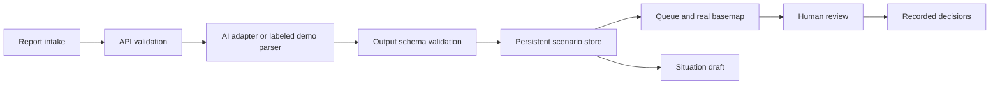

# Afterlight

**A clearer picture from scattered reports.** A working incident intelligence prototype for fictional preparedness exercises, based on the supplied Afterlight playbook.

The app combines report intake, structured extraction, a real Seattle waterfront basemap with simulated report markers, editable human review, explainable priority suggestions, duplicate comparisons, situation drafts, and an activity log. It starts with ten synthetic reports in the Harborlight flood exercise.

## Run locally

Requires Node.js 22.9 or newer. No package installation is necessary; the Leaflet browser assets are included. Internet access is needed for the real basemap tiles.

```powershell
# Open a terminal in this extracted afterlight folder.
npm start
```

Open **http://127.0.0.1:4173**. Data persists in `data/scenario.json`. Exercise settings can reset it. To use another port, set `PORT` in `.env`. `npm run dev` watches the server sources.

```powershell
npm test
npm run check
```

## AI connection

Copy `.env.example` to `.env` and set `AI_API_KEY`, `AI_MODEL`, and `AI_BASE_URL` for an OpenAI-compatible chat completions endpoint. Keep credentials on the server. Restart after changing configuration. Use a vision-capable model for image attachments. The connection sends synthetic report text and optional images to the configured provider.

Without credentials, the app uses a deterministic text parser and clearly labels **Rule-based demo**. It does not analyze image pixels. A provider timeout, invalid schema, or request failure falls back to that parser while retaining the report. The review panel offers retry. Human edits survive retries. No live AI provider has been validated in this environment; the automated tests use a local fake provider.

## Demo in two minutes

1. Open Overview and inspect the queue, map, and uncertainty fields.
2. Choose **New report → Use the prepared demo report → Submit report**.
3. Choose **Review report**, adjust the summary or priority, and save.
4. Compare a possible related report and mark it related or distinct.
5. Generate a situation draft and export it as Markdown.
6. Open Activity log to inspect the recorded decisions.
7. Reset from Exercise settings to repeat the demo.

## Architecture

The implemented stack is dependency-free browser JavaScript/CSS and a Node.js HTTP API, with a serialized, atomically replaced JSON store. This is a deliberate simplification of the playbook's recommended Next.js/Supabase stack: it provides a complete local demo without external accounts, installation, or a database service. Components are split into domain, AI adapter, store, server, and browser UI modules. Leaflet 1.9.4 is included as a locally served browser library.



The browser uses locally vendored Leaflet and loads real OpenStreetMap tiles over HTTPS. It shows visible OpenStreetMap attribution, relies on normal browser caching, and does not prefetch areas or offer offline map downloads. The seven fixed exercise points and their names are fictional even though the basemap shows real Seattle geography. Unknown report locations remain unmapped. The server has no external runtime packages; no CDN scripts or analytics are used. Leaflet license notices are preserved in `public/vendor/leaflet/LICENSE`. The illustration and app identity SVGs were authored for this project.

## Hosting

Use a **single persistent Node service** on a container/PaaS host. Set `HOST=0.0.0.0`, a strong `DEMO_ACCESS_TOKEN`, and a writable `DATA_DIR` backed by persistent storage. Terminate HTTPS at the host. Judges enter the demo token in the UI; include it privately in Devpost. Keep the same service available for the judging period. Do not place this file-backed store on ephemeral or horizontally scaled serverless instances.

```powershell
docker build -t afterlight .
docker run --rm -p 4173:4173 -e DEMO_ACCESS_TOKEN="replace-with-a-long-random-token" -v afterlight-data:/app/data afterlight
```

The Docker image and public hosting have not been run here. A public GitHub repository and app URL are still required for submission. The local preview is not a public deployment.

## Kiro and hackathon status

**The initial prototype was built in Codex. Kiro IDE refined the specs and implemented reviewer-owned affected-people and needs corrections on November 21, 2026.** Kiro added validation, persistence/retry/provenance tests, and a contribution record. Codex independently reviewed and corrected that work. See `docs/KIRO_CONTRIBUTION.md`, `docs/CODEX_REVIEW.md`, and `docs/KIRO_HANDOFF.md` for attribution and evidence. The final test suite has 55 passing tests. Public hosting, repository, YouTube video, and Devpost submission remain pending; judges decide whether the extent of Kiro use satisfies the rules.

See `docs/HACKATHON_REVIEW.md` for verified dates, fit, and outstanding requirements; `docs/SUBMISSION_DRAFT.md` for an editable pitch; and `docs/DEMO_SCRIPT.md` for a 2:50 recording outline.

## Practical limits

- Fictional exercise data only. No emergency dispatch, image verification, or operational advice.
- Priorities are review queue suggestions computed from report claims and a visible rubric. Human reviewers decide the final band.
- Extraction confidence is a parsing indicator, not a calibrated truth probability. The demo parser uses a fixed 55% indicator.
- Duplicate similarity is a heuristic, not a probability. Related records are never automatically merged, suppressed, or deduplicated in counts.
- Summaries count reports rather than verified events or unique affected people. They are snapshots, so generate a new draft after edits.
- The activity log records changes but is not cryptographically immutable. Reset clears it.
- Persistence supports one process. Use a transactional database before multi-instance hosting or production use.
- AI responses are untrusted; schema validation constrains their shape, but human review remains necessary for factual accuracy.

MIT licensed. No sensitive data or service keys are included.
